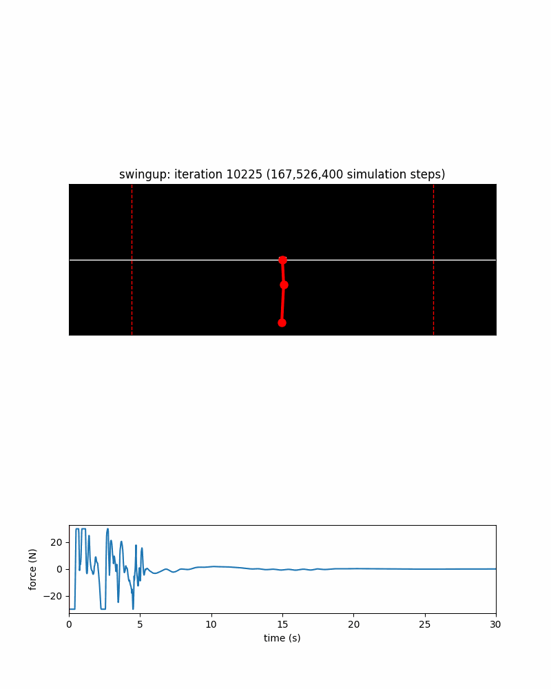
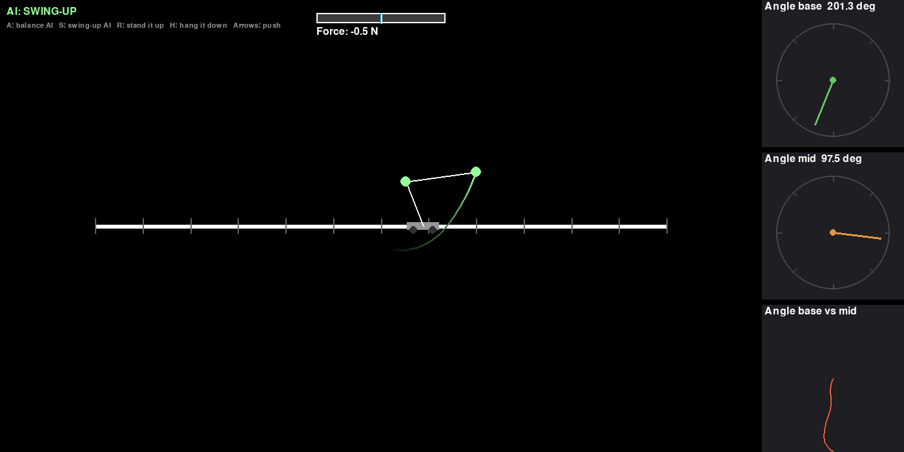
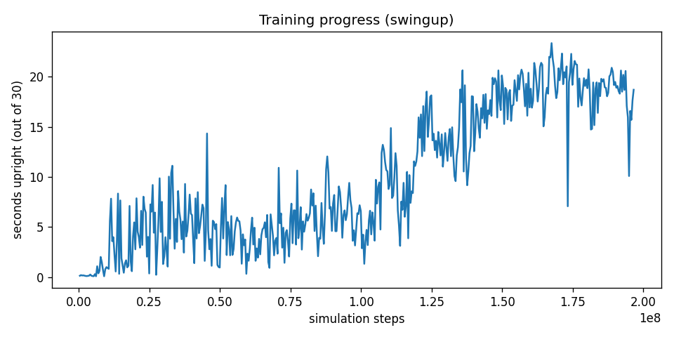

# Double Pendulum

A double pendulum on a cart, simulated from scratch, with a neural network that learns to swing it up from hanging still and keep it balanced upside down.

Run `python game.py` to play. Push the cart with the arrow keys, or press S to let the AI swing it up and A to let it balance. H drops it back to the bottom and R stands it up.

## How it works

The physics comes from Lagrangian mechanics. I derived the equations of motion with sympy and step them forward with RK4. The cart can push with up to 30 N and has 12 m of track to work with.

I wrote my first neural network by hand in `neural.py` to learn how forward passes and backprop actually work. `train.py` uses the same ideas in numpy to train the controllers with PPO. The network sees where the cart is and how the arms are moving, and decides what force to push with.

Balancing was the easy part. Swinging up was much harder, so it learns backwards. It starts by catching the pendulum just after it tips over from the top, then from longer and longer falls, until it can get all the way up from hanging still. It now makes it up about 98% of the time, usually in around 6 seconds.

The GIFs in `outputs/swingup/progress` show it at different points in training, from flailing about to swinging up properly.

## Helpful resources I used

https://matthias-research.github.io/pages/publications/XPBD.pdf

https://lpsa.swarthmore.edu/NumInt/NumIntFourth.html

https://medium.com/data-science/lets-code-a-neural-network-in-plain-numpy-ae7e74410795
